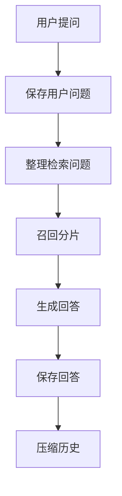
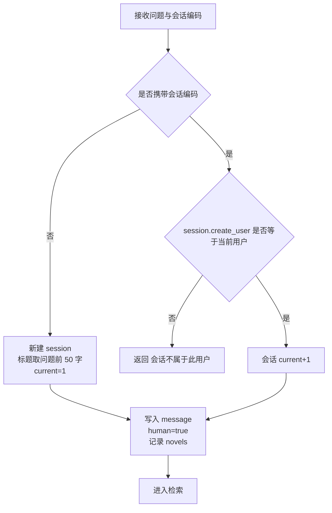
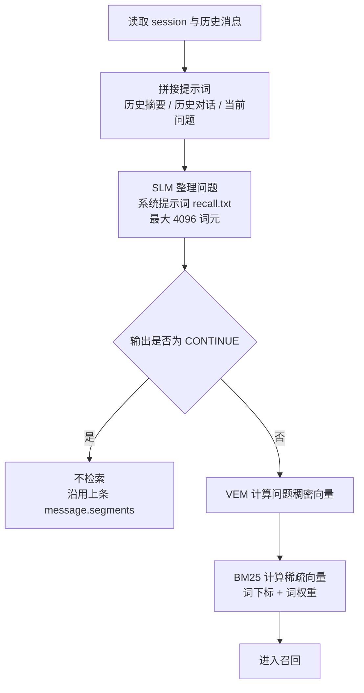
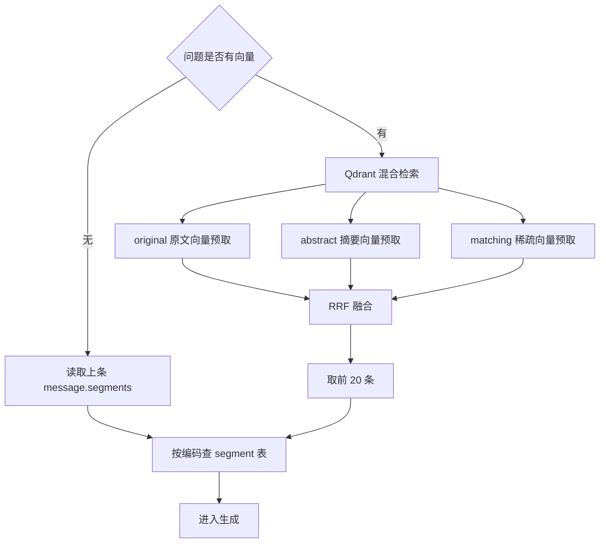
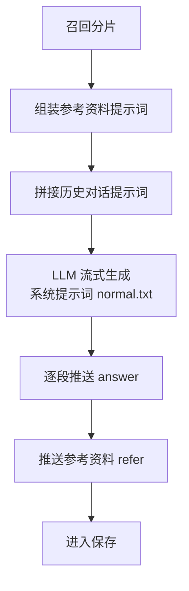
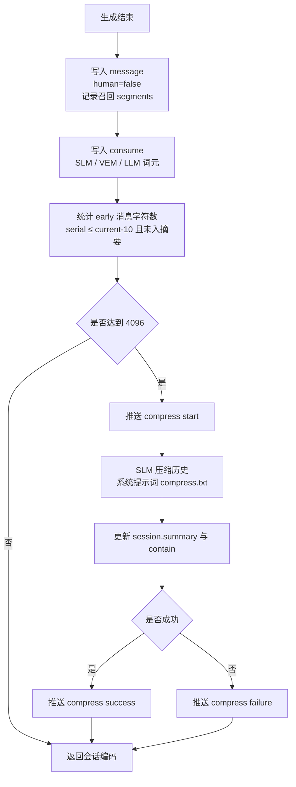

# 回答问题流程

问答接口为 SSE 流式响应，服务端在同一个请求内完成"保存问题 → 检索 → 生成 → 保存回答 → 压缩历史"。

## 1. 主流程

一次提问进入接口后，先确认会话并保存用户问题，再由小模型把当前问题与历史对话整理成检索用的表述；随后用该表述召回相关分片，把分片作为参考资料、把历史对话作为上下文拼成提示词，交给大模型流式生成回答；回答推送完毕后保存助手消息与词元消耗，最后判断早期消息是否累积过多，达到阈值就压缩为历史摘要。压缩发生在回答返回之后，不影响本轮已经输出的内容。

## 2. 保存用户问题

请求可能携带已有会话编码，也可能是新会话。新会话由服务端创建 session 并直接写入第一条消息（序号 1）；已有会话先校验其创建人是否等于令牌中的用户编码，通过后把 current 加一，再按新序号插入消息。两种情况下都会记录本次参考的小说编码，校验失败则不写入任何数据。

## 3. 整理检索问题

会话摘要、contain 之后的历史消息、当前问题这三部分被拼成提示词，交给小模型整理成适合检索的表述。若小模型输出 CONTINUE，表示当前问题是承接上一轮的话题，不需要重新检索，直接沿用上一条消息记录的分片；否则把整理后的问题交给向量模型得到稠密向量，同时分词得到稀疏向量的下标与权重。

## 4. 召回分片

有检索表述时向向量库发起混合检索：原文向量、摘要向量、稀疏向量各自预取候选，再由 RRF 融合排序，取前 20 条，并限定在本次请求携带的小说范围内。没有检索表述（CONTINUE 或稀疏向量为空等退化情况）时按上一条消息记录的分片编码回查分片表。

## 5. 生成回答

召回的分片组装成参考资料提示词，历史对话组装成会话提示词，两者拼接后作为用户内容，连同 normal.txt 系统提示词交给大模型流式生成。每生成一段即推送给前端；生成结束后单独推送一次参考资料，内容为分片编码、小说、章节、序号。中途出错时保留已生成的部分，并把消息标记为未完成。

## 6. 保存回答与压缩历史

助手消息写入 message（human = false），同时记录本次召回的分片编码；本次各模型调用的提示词与回答词元数写入 consume。之后统计"序号不大于 current-10、且尚未纳入摘要"的消息总字符数，达到 4096 就触发压缩：先推送 start，再由小模型按 compress.txt 把这段历史压成摘要，写回会话的 summary 与 contain，最后根据结果推送 success 或 failure。压缩只影响下一轮的上下文，失败也不会让本次请求失败。

