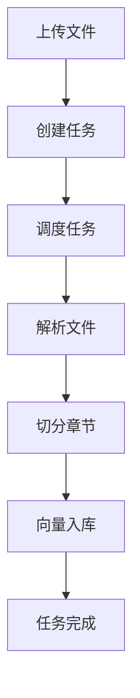
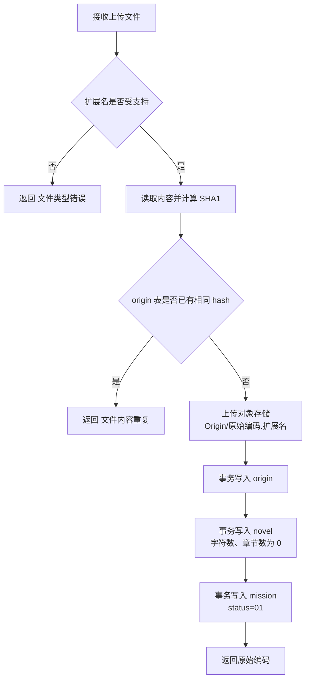
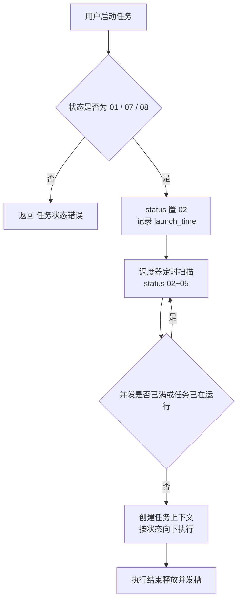
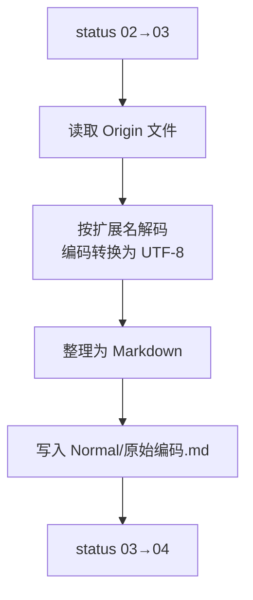
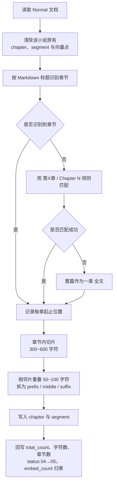
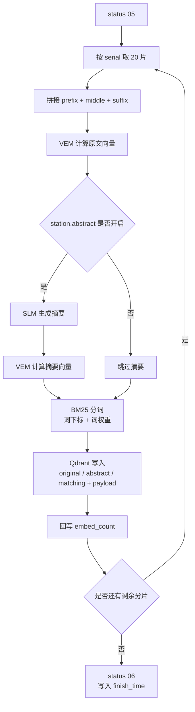
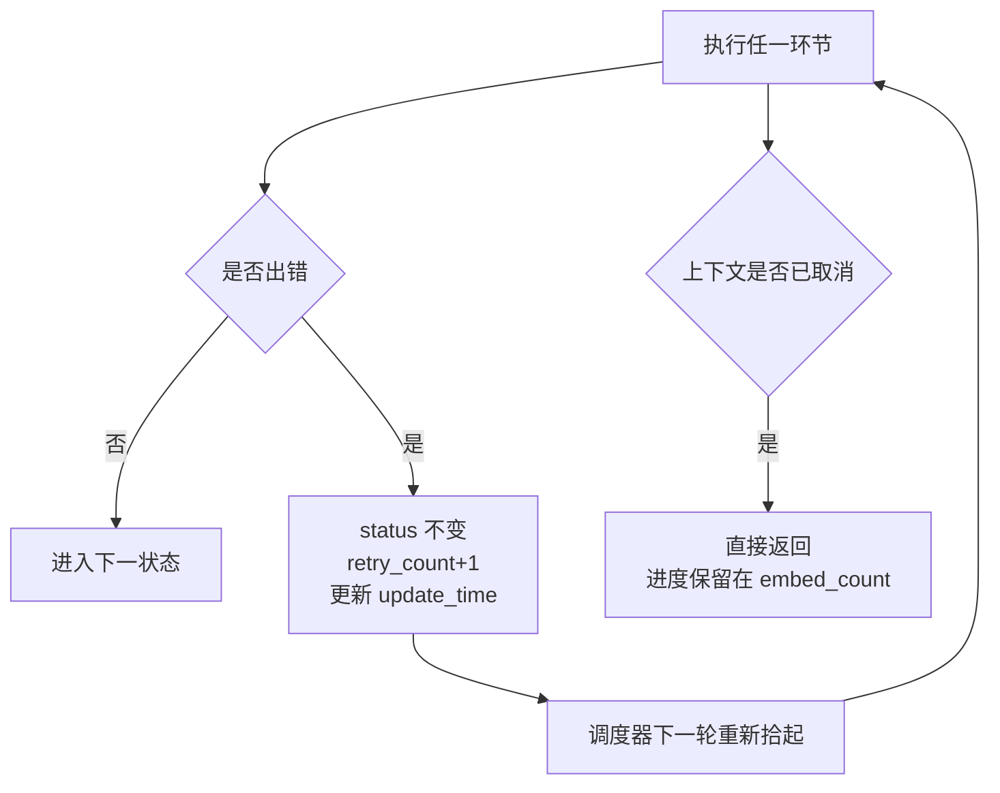

# 知识入库流程

知识入库由两部分组成：上传接口在请求内完成落库与对象存储，之后由后台调度器按任务状态依次执行解析、切分、向量化。

任务状态：01 待启动、02 已启动、03 解析中、04 切分中、05 向量中、06 已完成、07 已失败、08 已取消。

## 1. 主流程

用户上传文件后，接口立即校验并落库，同时创建一条待启动的任务；用户启动任务后，任务状态变为已启动，之后由后台调度器接管。调度器依次推进三个阶段：解析（把原始文件转成统一的 Markdown）、切分（按章节拆成章节记录，再把章节切成带重叠的分片）、向量入库（逐批把分片写入向量库）。全部完成后任务置为已完成。

## 2. 上传文件

接口先检查扩展名是否在支持列表内，再读取全部内容计算 SHA1，若 origin 表已有相同 hash 则判为重复文件。通过后把文件上传到对象存储的 Origin 前缀下，并在一个事务里写入三张表：origin 记录文件名称、类型、大小与 hash；novel 记录标题（取文件名），字符数与章节数暂为 0；mission 以状态 01 创建，各项计数归零。上传成功只代表文件已落库，此时尚未开始解析。

## 3. 启动与调度

只有 01（待启动）、07（已失败）、08（已取消）的任务允许启动，启动时状态置为 02 并记录启动时间。调度器定时扫描状态为 02~05 的任务，启动前检查活动任务索引：数量已达并发上限、或该任务已在运行时跳过。每个任务在独立协程中执行，并持有可取消的上下文；执行结束后释放并发槽。

## 4. 解析文件

任务状态从 02 进到 03 后，从对象存储读取 Origin 下的原始文件，按扩展名解码并处理编码问题（含 GBK 转 UTF-8），统一整理为 Markdown，另存到 Normal 前缀下（对象名为"原始编码.md"）。成功后状态进到 04。

## 5. 切分章节

切分前先清除该小说原有的章节、分片记录以及向量库中的对应点。随后按 Markdown 标题识别章节，识别不到则用"第X章/节/回"与 Chapter N 之类的规则匹配，仍无结果就把整篇作为一章"全文"，同时记录每章在文档中的起止位置。章节内部按 300~600 字符切片，相邻分片保留 50~100 字符的重叠：重叠部分作为上一片的 suffix、下一片的 prefix，净内容作为 middle；首片没有 prefix，末片没有 suffix。写入 chapter 与 segment 后，一次性事务回写任务的分片总数与小说的字符数、章节数，状态进到 05，入库进度归零。

## 6. 向量入库

以分片序号为游标，每批读取 20 片，把 prefix、middle、suffix 按换行拼成完整内容。每片计算三类向量：向量模型对完整内容计算原文向量；若摘要开关开启，先由小模型生成摘要、再对摘要计算向量；同时对同一份内容分词得到稀疏向量的下标与权重。三类向量连同小说、章节、序号三项 payload 一次写入向量库。每批结束后回写入库进度，全部完成则任务置为 06 并记录完成时间。

## 7. 中断与重试

每批开始前检查上下文是否已取消，取消则直接返回，进度保留在入库计数中。任一环节出错时任务状态不变，重试次数加一并更新修改时间，由调度器在下一轮重新拾起：解析与切分从头执行，向量入库从上次的进度继续，已入库的分片不会重复计算。需要整本重新入库时，把状态改回 05、进度置 0、完成时间置空即可。

